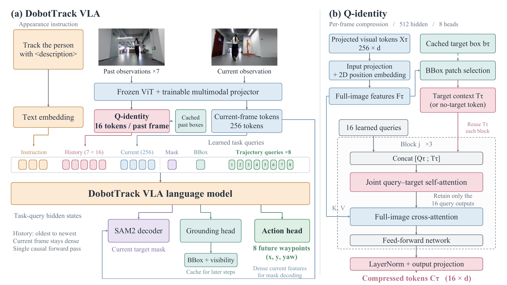
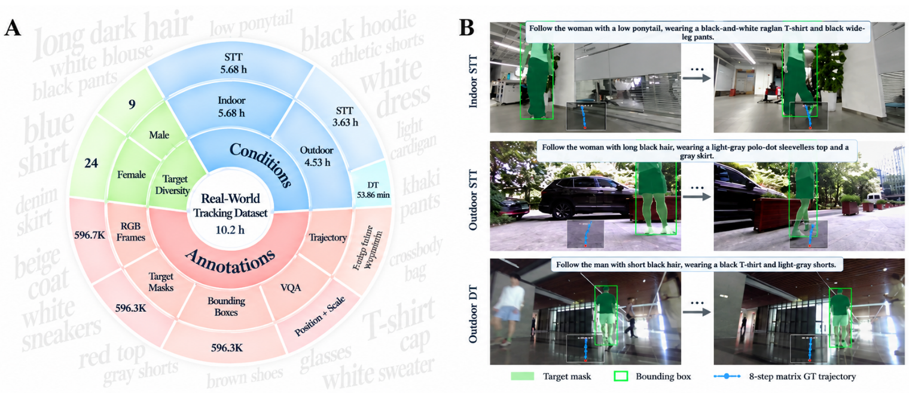

<div align="center">

# DobotTrack

### Target-Grounded Vision-Language-Action Learning for Embodied Person Following

Shengjun Deng<sup>1</sup>, Yinghan Zhang<sup>2,*</sup>, Chengrui Wei<sup>3</sup>, Liu Liang<sup>3</sup>, Songyuan Liu<sup>3</sup><br>
Pengkun Zheng<sup>3,†</sup>, Yajun Zheng<sup>3</sup>, Ying Zhang<sup>3</sup>, Yuan Tian<sup>3</sup>, Xi Li<sup>3</sup>, Teng Wang<sup>4,*</sup>

<sup>1</sup>Foshan University &nbsp; <sup>2</sup>Tsinghua University<br>
<sup>3</sup>Dobot Robotics &nbsp; <sup>4</sup>The University of Hong Kong<br>
<sup>*</sup>Corresponding authors &nbsp; <sup>†</sup>Project lead

**GitHub Page (Coming soon) · Dataset (Coming soon) · Paper (Coming soon)**

</div>

## Overview

**DobotTrack** follows a person specified by a natural-language appearance description. It combines complementary **mask and box supervision** with **Q-identity**, a target-grounded visual history compressor, to predict future egocentric waypoints from a temporal window of RGB observations.



## News

- **[2026-10-30]** Training and Habitat evaluation code are available.

## Real-world dataset

The manuscript describes **126 quadruped person-following episodes**, approximately **10.2 hours**, with **33 target appearance profiles** across indoor and outdoor conditions.



| Data stage | Count |
|---|---:|
| Original RGB frames | 596,669 |
| Mask-annotated frames | 596,323 |
| Training samples after alignment and trajectory preprocessing | 565,994 |
| Front-facing RGB resolution | 960 × 540 |

Target localization with Qwen3.5 and segmentation with SAM3 are followed by manual review and correction. Clean masks provide target boxes and horizontal-position / apparent-scale labels.

## 1. Installation

Habitat simulation requires **Habitat-Sim 0.3.1 with Bullet**, matching the TrackVLA / EVT-Bench setup. Use **Python 3.10** for DobotTrack's model and SAM2 code. Dependency ranges are listed in [requirements.txt](requirements.txt).

### 1.1 NVIDIA OpenGL

Check the installed driver with `nvidia-smi`. On Ubuntu, match the NVIDIA OpenGL package to its driver branch; replace `570` below with your installed branch:

```bash
nvidia-smi
sudo apt-get install libnvidia-gl-570
sudo apt-get install --reinstall libglvnd-dev
sudo apt-get install ffmpeg
```

### 1.2 Build Habitat-Sim from source

Use a Python 3.10 virtual environment and compile the pinned `v0.3.1` release. The `--with-cuda` option requires an installed CUDA Toolkit with `nvcc`, in addition to the NVIDIA driver.

```bash
python3.10 -m venv ~/.venvs/dobottrack-sim
source ~/.venvs/dobottrack-sim/bin/activate
python -m pip install --upgrade pip
python -m pip install "setuptools<70" wheel "cmake>=3.18,<4" ninja "numpy<2"

sudo apt-get install -y build-essential git pkg-config ninja-build \
  libjpeg-dev libglm-dev libgl1-mesa-dev libegl1-mesa-dev \
  mesa-utils xorg-dev freeglut3-dev
nvcc --version

mkdir -p ~/src
cd ~/src
git clone --branch v0.3.1 --recursive \
  https://github.com/facebookresearch/habitat-sim.git habitat-sim-v0.3.1
cd habitat-sim-v0.3.1
python -m pip install -r requirements.txt "numpy<2"
python setup.py install --headless --with-cuda --bullet
python -c "import habitat_sim, magnum; print(habitat_sim.__version__)"
```

The flags enable headless rendering, CUDA features, and Bullet physics. See the upstream [source-build instructions](https://github.com/facebookresearch/habitat-sim/blob/v0.3.1/BUILD_FROM_SOURCE.md).

### 1.3 DobotTrack, Habitat-Lab, and PyTorch

Continue in the activated virtual environment:

```bash
cd ~/src
git clone --branch paper-grounding-before-action-default \
  https://gitee.com/inffni-robotics/embodvla.git
cd embodvla

python -m pip install --upgrade pip
python -m pip install -r requirements.txt "numpy<2" tensorboard
python -m pip install -e trackvla_bench/habitat-lab
```

Use a CUDA-capable PyTorch build compatible with the GPU and driver. The project requires `torch>=2.5.1`, `torchvision>=0.20.1`, and Transformers with native InternVL3 support. Keep the simulator-compatible NumPy constraint when installing additional dependencies.

### 1.4 SAM2 source

For mask supervision, prepare the local SAM2 source and a SAM2.1 Base+ checkpoint. The source directory is ignored by Git and is not included in a fresh clone.

```bash
git clone https://github.com/facebookresearch/sam2.git vla/sam2
git -C vla/sam2 checkout 2b90b9f5ceec907a1c18123530e92e794ad901a4
```

Set `model.sam2_config.checkpoint` to the checkpoint file. Prepare the scenes, humanoids, robot assets, and benchmark episodes below before launching simulation.

## 2. Simulator assets and training data

Closed-loop evaluation requires benchmark episodes, scenes, humanoids, and robot assets. `--trackvla-root` accepts a TrackOpen checkout or an asset pack containing `data/`. Code and assets may be provided separately with `--trackvla-code-root` and `--trackvla-assets-root`.

```text
/path/to/trackvla_bench/
├── habitat-lab/                  # Habitat code and benchmark YAMLs
├── evt_bench/                    # Tracking task / action registrations
└── data/
    ├── datasets/track/           # DT / STT / AT episodes
    ├── scene_datasets/           # Scene assets referenced by episodes
    ├── humanoids/
    └── robots/
```

Use asset paths matching the benchmark YAMLs and episode scene references. These assets are prepared externally and are not shipped with this repository.

### Simulation data collection

The four scripts in `trackvla_bench/` provide expert rollout collection, reversed-episode generation, and training-sample packing. Run the following commands in the activated `dobottrack-sim` virtual environment after preparing the assets above.

**1. Collect expert rollouts.** From the repository root, enter `trackvla_bench/` so relative asset paths resolve correctly:

```bash
cd trackvla_bench
PYTHONPATH="$PWD/habitat-lab:$PWD:${PYTHONPATH:-}" python run.py \
  --run-type eval \
  --exp-config habitat-lab/habitat/config/benchmark/nav/track/track_train_dt.yaml \
  --split-id 0 --split-num 1 \
  --save-path ../outputs/collection/dt/seed_101 \
  habitat.simulator.seed=101
```

`run.py` uses `--run-type eval` to execute the expert collector, even when reading **training** episodes; its `train` mode is not implemented. Repeat with `track_train_stt.yaml` and `track_train_at.yaml`, using separate `stt/seed_101` and `at/seed_101` output directories. The collector writes RGB / mask videos, motion records (`*_info.json`), and episode summaries.

For deterministic full-coverage chunks, add `--full-coverage-splits --episodes-per-split N`, set `--split-num` to `ceil(total_episodes / N)`, and run all split IDs. Give parallel collectors separate output roots.

**2. Pack successful rollouts into training samples.** From the same directory:

```bash
python make_track_data.py \
  --input_root ../outputs/collection/dt \
  --output_root ../outputs/sim_dataset/dt_train \
  --only_success --horizon 8 --dt 0.1
```

The packer expects `seed_*/<scene>/` under the input root, as produced by the command above. It creates `frames/`, `masks/`, `jsonl/`, and `dataset.json`, integrating recorded motions into 8 future egocentric waypoints with `dt=0.1`. Repeat for STT and AT. Observation histories are assembled during training with `data.num_history_frames=8` and `data.history_frame_interval=1` (historical stride 2). Subsample the three sources toward STT:DT:AT = **1:2:1** with a fixed sampling rule; this balancing is a separate step, not performed by `make_track_data.py`.

## 3. Model weights

Prepare an **InternVL3 local Hugging Face model directory** and, when using mask supervision, a **SAM2.1 Base+ checkpoint**. Configure their paths in the training YAML.

A trained policy should be distributed together with its resolved configuration:

```text
/path/to/experiment/checkpoints/
├── model.ckpt
└── config.yaml
```

Evaluation reconstructs the model from this configuration.

## 4. Evaluation

Run the following commands from the repository root in the prepared simulation environment.

Launch the complete evaluation set:

```bash
bash scripts/run_trackvla_habitat_eval.sh \
  --checkpoint /path/to/experiment/checkpoints/model.ckpt \
  --config /path/to/experiment/checkpoints/config.yaml \
  --trackvla-root /path/to/trackvla_bench \
  --exp-config habitat-lab/habitat/config/benchmark/nav/track/track_infer_dt.yaml \
  --gpus 0,1,2,3,4,5,6,7 --chunks 1405 \
  --save-path outputs/evaluation/dt --seed 42
```

Select the corresponding `track_infer_stt.yaml` or `track_infer_at.yaml` for STT / AT. Saved outputs include episode JSON, shard summaries, and optional MP4 videos.

## 5. Training

Use the [Q-identity + Box + Mask configuration](configs/dobottrack_internvl3_1b_q_identity_box_mask.yaml). Set the local model, SAM2 weights, simulation data, and real-data paths in the YAML.

```bash
cp configs/dobottrack_internvl3_1b_q_identity_box_mask.yaml configs/local.yaml

# Train on 8 GPUs
python -m torch.distributed.run --standalone --nproc-per-node=8 \
  scripts/train.py --config configs/local.yaml
```

## 6. Deployment

See [Jetson Orin deployment](deploy/dobottrack/README.md) for checkpoint export, W8A8 calibration, TensorRT builds, and streaming inference.

## Results

Each cell is **SR ↑ / TR ↑ / CR ↓ (%)**. Multi-camera methods are reference results and are listed separately from single-view policies. `*` denotes co-training with general navigation data; `–` preserves an unavailable value or the source table's RL notation.

### Multi-camera references

| Method | Size | RL | STT | DT | AT |
|---|---:|:---:|---|---|---|
| ABot-N0* | 4B | – | 86.9 / 87.6 / 8.54 | 66.7 / 75.4 / 11.6 | 67.3 / 79.5 / 7.05 |
| NavFoM* | 7B | – | 88.4 / 80.7 / – | 62.0 / 67.9 / – | – |
| CoMaTrack* | 3B | ✓ | 92.1 / 90.3 / 0.9 | 74.2 / 80.5 / 2.1 | 57.5 / 73.4 / 12.0 |
| TrackVLA++ | 7B | – | 90.9 / 82.7 / 1.50 | 74.0 / 73.7 / 3.51 | 55.9 / 63.8 / 15.1 |

### Single-view comparison

| Method | Size | RL | STT | DT | AT |
|---|---:|:---:|---|---|---|
| Uni-NaVid* | 7B | – | 53.3 / 67.2 / 12.6 | 31.9 / 50.1 / 21.3 | 15.8 / 41.5 / 26.5 |
| NavFoM* | 7B | – | 85.0 / 80.5 / – | 61.4 / 68.2 / – | – |
| VLingNav* | 7B | ✓ | 88.4 / 81.2 / 2.1 | 67.7 / 73.5 / 5.5 | – |
| TrackVLA | 7B | – | 85.1 / 78.6 / 1.7 | 57.6 / 63.2 / 5.8 | 50.2 / 63.7 / 17.1 |
| TrackVLA++ | 7B | – | 86.0 / 81.0 / 2.10 | 66.5 / 68.8 / 4.71 | 51.2 / 63.4 / 15.9 |
| ReferTrack | 4B | – | 89.4 / 92.5 / 1.6 | 73.3 / 81.8 / 7.6 | 74.1 / 85.7 / 7.7 |
| **DobotTrack** | **0.8B** | – | **90.2 / 92.3 / 3.6** | **72.5 / 83.3 / 8.3** | **70.9 / 85.5 / 6.6** |

The DobotTrack results are reported in the current manuscript; they are not yet bound to a public checkpoint and frozen evaluation configuration in this repository.

## Acknowledgments

We thank the teams behind InternVL, SAM2, OmTrackVLA, TrackVLA / EVT-Bench, and Habitat.
